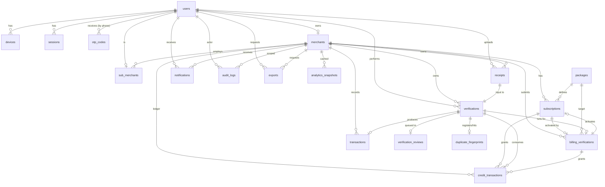

# Database Schema Design

> Last updated: 2026-09-24 | Owner: Kiro
> Status: **APPROVED** — input to Step 6 (Prisma Schema + Migrations)
> This is the design-only document. No Prisma code is here.

---

## 1. Design Principles

Before reading any table, internalize these rules. Every decision below
flows from them.

1. **UUID v7 for all primary keys.** Time-sortable, globally unique, safe
   to expose in URLs. Generated in the app layer via `uuidv7()`.
2. **`created_at` + `updated_at` on every mutable table.** `TIMESTAMPTZ`,
   UTC. Maintained by a trigger.
3. **Soft delete via `deleted_at`** on user-facing entities. Hard delete
   only by an admin purge job.
4. **Money = integer minor units only.** Column suffix `_minor`, type
   `BIGINT`. 199.00 ETB = `19900`. Never `DECIMAL`, `FLOAT`, `NUMERIC`.
5. **Tenant column on every scoped table.** `merchant_id UUID NOT NULL`
   with FK + index. RLS policy uses it.
6. **Postgres native enums for stable sets.** Adding a value = new
   migration. No string columns where an enum fits.
7. **JSONB only for flexible payloads** (OCR raw text, adapter metadata,
   ML feature vectors). Not for core relational data.
8. **Immutable tables** (`credit_transactions`, `audit_logs`,
   `bank_reference_lookups`) have no `updated_at`, no `deleted_at`, and
   Postgres rules blocking `UPDATE` and `DELETE`.
9. **Every FK is indexed.** Every column used in `WHERE`/`ORDER BY` is
   indexed. Composite indexes for known query patterns.
10. **No nullable columns unless semantically meaningful.** Prefer
    explicit defaults or separate optional-attribute tables.
11. **No SQL reserved words as identifiers.** (`user` → `app_user` in
    ORM, `order` → N/A here).
12. **External bank references** stored as `TEXT`, normalized (trimmed,
    uppercased) at write time.
13. **Defense in depth.** RLS at the DB layer + `merchant_id` filter at
    the application layer. Both, always.

---

## 2. Enums

```sql
-- User & access
CREATE TYPE user_role        AS ENUM ('ADMIN', 'MERCHANT', 'SUB_MERCHANT');
CREATE TYPE user_status      AS ENUM ('ACTIVE', 'SUSPENDED', 'BANNED', 'DELETED');
CREATE TYPE merchant_status  AS ENUM ('PENDING', 'ACTIVE', 'SUSPENDED', 'BANNED');
CREATE TYPE sub_merchant_status AS ENUM ('INVITED', 'ACTIVE', 'SUSPENDED', 'REMOVED');
CREATE TYPE device_platform  AS ENUM ('ANDROID', 'IOS');
CREATE TYPE otp_purpose      AS ENUM ('LOGIN', 'DEVICE_BIND', 'PHONE_CHANGE');

-- Banking & verification
CREATE TYPE bank_code        AS ENUM (
  'CBE', 'TELEBIRR', 'AWASH', 'DASHEN', 'ABYSSINIA', 'MPESA', 'ZEMEN'
);
CREATE TYPE verification_status AS ENUM (
  'PENDING', 'VERIFIED', 'FAKE', 'DUPLICATE', 'NEEDS_REVIEW', 'ERROR'
);
CREATE TYPE verification_source AS ENUM ('TRANSACTION', 'BILLING');
CREATE TYPE verification_input  AS ENUM ('PHOTO', 'UPLOAD');
CREATE TYPE transaction_status  AS ENUM (
  'PENDING', 'VERIFIED', 'FAKE', 'DUPLICATE', 'NEEDS_REVIEW', 'ERROR'
);

-- Billing & credits
CREATE TYPE package_code       AS ENUM ('FREE', 'PREMIUM', 'BUSINESS', 'BUSINESS_PRO', 'API');
CREATE TYPE subscription_status AS ENUM (
  'ACTIVE', 'EXPIRED', 'CANCELLED', 'PENDING_PAYMENT'
);
CREATE TYPE credit_tx_type AS ENUM (
  'GRANT', 'CONSUME', 'REFUND', 'ADJUSTMENT', 'EXPIRE'
);
CREATE TYPE billing_status AS ENUM (
  'PENDING', 'VERIFIED', 'AMOUNT_MISMATCH', 'DUPLICATE', 'FAKE',
  'NEEDS_REVIEW', 'APPROVED', 'REJECTED'
);

-- Reviews, notifications, exports
CREATE TYPE review_status        AS ENUM ('OPEN', 'IN_REVIEW', 'RESOLVED', 'REJECTED');
CREATE TYPE notification_channel AS ENUM ('PUSH', 'IN_APP', 'EMAIL');
CREATE TYPE notification_type    AS ENUM (
  'VERIFICATION_RESULT', 'CREDIT_LOW', 'CREDIT_EXHAUSTED',
  'BILLING_APPROVED', 'BILLING_REJECTED',
  'SUB_MERCHANT_INVITED', 'SUB_MERCHANT_JOINED', 'SYSTEM'
);
CREATE TYPE export_format  AS ENUM ('CSV', 'PDF');
CREATE TYPE export_status  AS ENUM ('QUEUED', 'PROCESSING', 'READY', 'FAILED', 'EXPIRED');
CREATE TYPE actor_type     AS ENUM ('USER', 'SYSTEM', 'ADMIN');
```

---

## 3. Tables

### 3.1 `users`

Identity table. Every human actor — admin, merchant owner, or sub-merchant
employee — is a user. Phone + OTP is the only auth mechanism (no password,
no email in MVP).

| Column | Type | Constraints | Notes |
|--------|------|-------------|-------|
| `id` | UUID | PK | UUID v7 |
| `phone` | TEXT | UNIQUE NOT NULL | E.164 `+2519xxxxxxxx`. Normalized at write. |
| `phone_verified_at` | TIMESTAMPTZ | | Set when OTP first verified |
| `full_name` | TEXT | NOT NULL | |
| `role` | user_role | NOT NULL | |
| `status` | user_status | NOT NULL DEFAULT 'ACTIVE' | |
| `preferred_language` | TEXT | NOT NULL DEFAULT 'en' | `'en'` or `'am'` |
| `last_login_at` | TIMESTAMPTZ | | |
| `created_at` | TIMESTAMPTZ | NOT NULL DEFAULT now() | |
| `updated_at` | TIMESTAMPTZ | NOT NULL DEFAULT now() | Trigger-maintained |
| `deleted_at` | TIMESTAMPTZ | | Soft delete |

**Indexes:** `phone` (unique), `role`, `status`

**Constraints:**
```sql
CHECK (phone ~ '^\+251[0-9]{9}$')
CHECK (preferred_language IN ('en', 'am'))
```

---

### 3.2 `otp_codes`

Hashed OTP storage. Raw OTP is **never** stored. Purged after 24 hours.

| Column | Type | Constraints | Notes |
|--------|------|-------------|-------|
| `id` | UUID | PK | |
| `phone` | TEXT | NOT NULL | Not FK — OTP may precede user creation |
| `purpose` | otp_purpose | NOT NULL | |
| `code_hash` | TEXT | NOT NULL | bcrypt hash of the OTP |
| `attempts` | INT | NOT NULL DEFAULT 0 | |
| `max_attempts` | INT | NOT NULL DEFAULT 5 | |
| `expires_at` | TIMESTAMPTZ | NOT NULL | now() + 5 minutes |
| `consumed_at` | TIMESTAMPTZ | | Set on successful use |
| `ip` | INET | | Rate limit / audit |
| `user_agent` | TEXT | | |
| `created_at` | TIMESTAMPTZ | NOT NULL DEFAULT now() | |

**Indexes:** `(phone, purpose, created_at DESC)`, `expires_at` (for purge job)

**Retention:** Nightly job hard-deletes rows older than 24 hours.

---

### 3.3 `devices`

Trusted devices bound to a user. Max 3 active (non-revoked) per user,
enforced at the service layer.

| Column | Type | Constraints | Notes |
|--------|------|-------------|-------|
| `id` | UUID | PK | |
| `user_id` | UUID | FK → users NOT NULL ON DELETE CASCADE | |
| `device_fingerprint` | TEXT | NOT NULL | Hash of device identifiers |
| `platform` | device_platform | NOT NULL | |
| `model` | TEXT | | e.g. "Samsung A54" |
| `os_version` | TEXT | | |
| `app_version` | TEXT | | |
| `push_token` | TEXT | | FCM token, rotatable |
| `push_token_updated_at` | TIMESTAMPTZ | | |
| `last_seen_at` | TIMESTAMPTZ | | |
| `revoked_at` | TIMESTAMPTZ | | Set when user revokes |
| `created_at` | TIMESTAMPTZ | NOT NULL DEFAULT now() | |

**Indexes:** `user_id`, `push_token` (partial WHERE `revoked_at IS NULL`),
UNIQUE `(user_id, device_fingerprint)` WHERE `revoked_at IS NULL`

---

### 3.4 `sessions`

Refresh-token sessions. One row per login. Rotation on every refresh.

| Column | Type | Constraints | Notes |
|--------|------|-------------|-------|
| `id` | UUID | PK | |
| `user_id` | UUID | FK → users NOT NULL ON DELETE CASCADE | |
| `device_id` | UUID | FK → devices NOT NULL | |
| `refresh_token_hash` | TEXT | NOT NULL UNIQUE | SHA-256 of the refresh token |
| `ip` | INET | | |
| `user_agent` | TEXT | | |
| `expires_at` | TIMESTAMPTZ | NOT NULL | now() + 30d |
| `revoked_at` | TIMESTAMPTZ | | Set on rotation or logout |
| `last_used_at` | TIMESTAMPTZ | | Updated on each use |
| `created_at` | TIMESTAMPTZ | NOT NULL DEFAULT now() | |

**Indexes:** `user_id`, `(user_id, revoked_at)`, `refresh_token_hash` (unique)

**Rotation policy:** On token refresh → set `revoked_at` on current row → insert new row. Old rows retained 30 days for audit, then purged.

---

### 3.5 `merchants`

The tenant entity. One merchant = one business. Every sub-merchant,
verification, transaction, and billing record belongs to a merchant.

| Column | Type | Constraints | Notes |
|--------|------|-------------|-------|
| `id` | UUID | PK | |
| `owner_user_id` | UUID | FK → users NOT NULL UNIQUE | One merchant per user |
| `business_name` | TEXT | NOT NULL | |
| `business_type` | TEXT | | "Cafe", "Hotel", etc. |
| `tin` | TEXT | | Tax ID (optional MVP) |
| `address` | TEXT | | |
| `city` | TEXT | | |
| `region` | TEXT | | |
| `status` | merchant_status | NOT NULL DEFAULT 'PENDING' | |
| `credits_balance` | BIGINT | NOT NULL DEFAULT 0 | **Cache only.** Source of truth = `credit_transactions` |
| `credits_updated_at` | TIMESTAMPTZ | | Last ledger reconciliation timestamp |
| `current_package_code` | package_code | | Denormalized for fast reads |
| `subscription_id` | UUID | FK → subscriptions | Current active subscription |
| `created_at` | TIMESTAMPTZ | NOT NULL DEFAULT now() | |
| `updated_at` | TIMESTAMPTZ | NOT NULL DEFAULT now() | |
| `deleted_at` | TIMESTAMPTZ | | |

**Indexes:** `owner_user_id` (unique), `status`, `current_package_code`

**⚠️ Credits balance rule:** `credits_balance` is a cached read-optimized column. The immutable `credit_transactions` ledger is always authoritative. A nightly reconciliation job compares them and alerts on any drift. Any code path that reads balance for gating (verification allowed?) reads `credit_transactions` sum, not this column.

---

### 3.6 `sub_merchants`

Employee / cashier accounts that verify on behalf of a merchant.

| Column | Type | Constraints | Notes |
|--------|------|-------------|-------|
| `id` | UUID | PK | |
| `merchant_id` | UUID | FK → merchants NOT NULL ON DELETE CASCADE | |
| `user_id` | UUID | FK → users NOT NULL UNIQUE | One role per user |
| `branch_label` | TEXT | | "Bole Branch", "Main Counter" |
| `status` | sub_merchant_status | NOT NULL DEFAULT 'INVITED' | |
| `invited_by_user_id` | UUID | FK → users | |
| `invited_at` | TIMESTAMPTZ | | |
| `joined_at` | TIMESTAMPTZ | | Set when OTP verified after invite |
| `permissions` | JSONB | NOT NULL DEFAULT '{}' | Future per-sub-merchant permission overrides |
| `created_at` | TIMESTAMPTZ | NOT NULL DEFAULT now() | |
| `updated_at` | TIMESTAMPTZ | NOT NULL DEFAULT now() | |
| `deleted_at` | TIMESTAMPTZ | | |

**Indexes:** `merchant_id`, `user_id` (unique), `status`

---

### 3.7 `packages`

Package catalog. Seeded from `shared/constants/packages.json` on deploy.

| Column | Type | Constraints | Notes |
|--------|------|-------------|-------|
| `code` | package_code | PK | |
| `name` | TEXT | NOT NULL | |
| `description` | TEXT | | |
| `price_minor` | BIGINT | | NULL for API plan (custom pricing) |
| `currency` | TEXT | NOT NULL DEFAULT 'ETB' | |
| `credits_per_month` | INT | | NULL = unlimited |
| `unlimited` | BOOLEAN | NOT NULL DEFAULT false | |
| `is_custom` | BOOLEAN | NOT NULL DEFAULT false | API plan = true |
| `display_order` | INT | NOT NULL DEFAULT 0 | UI sort order |
| `active` | BOOLEAN | NOT NULL DEFAULT true | |
| `created_at` | TIMESTAMPTZ | NOT NULL DEFAULT now() | |
| `updated_at` | TIMESTAMPTZ | NOT NULL DEFAULT now() | |

**Constraints:**
```sql
CHECK (price_minor IS NULL OR price_minor >= 0)
CHECK (credits_per_month IS NULL OR credits_per_month > 0)
```

---

### 3.8 `subscriptions`

Merchant's active and historical subscription records.

| Column | Type | Constraints | Notes |
|--------|------|-------------|-------|
| `id` | UUID | PK | |
| `merchant_id` | UUID | FK → merchants NOT NULL ON DELETE CASCADE | |
| `package_code` | package_code | FK → packages NOT NULL | |
| `status` | subscription_status | NOT NULL DEFAULT 'PENDING_PAYMENT' | |
| `started_at` | TIMESTAMPTZ | | Set when activated |
| `expires_at` | TIMESTAMPTZ | | |
| `cancelled_at` | TIMESTAMPTZ | | |
| `auto_renew` | BOOLEAN | NOT NULL DEFAULT false | Always false in MVP |
| `billing_verification_id` | UUID | FK → billing_verifications | The payment that activated this |
| `created_at` | TIMESTAMPTZ | NOT NULL DEFAULT now() | |
| `updated_at` | TIMESTAMPTZ | NOT NULL DEFAULT now() | |

**Indexes:** `merchant_id`, `(merchant_id, status)`, `expires_at`

**Partial unique index:**
```sql
CREATE UNIQUE INDEX subscriptions_one_active_per_merchant
  ON subscriptions (merchant_id)
  WHERE status = 'ACTIVE';
```

**Constraints:**
```sql
CHECK (expires_at IS NULL OR started_at IS NULL OR expires_at > started_at)
```

---

### 3.9 `credit_transactions`

**Immutable ledger.** Append-only. `UPDATE` and `DELETE` are blocked by
Postgres rules. Every change to a merchant's credit balance is a new row.

| Column | Type | Constraints | Notes |
|--------|------|-------------|-------|
| `id` | UUID | PK | |
| `merchant_id` | UUID | FK → merchants NOT NULL | |
| `type` | credit_tx_type | NOT NULL | |
| `amount` | BIGINT | NOT NULL | Positive for GRANT/REFUND, negative for CONSUME/EXPIRE |
| `balance_after` | BIGINT | NOT NULL | Running balance snapshot |
| `subscription_id` | UUID | FK → subscriptions | When type = GRANT |
| `verification_id` | UUID | FK → verifications | When type = CONSUME |
| `billing_verification_id` | UUID | FK → billing_verifications | When type = GRANT from billing |
| `reason` | TEXT | | Human-readable note for ADJUSTMENT |
| `actor_user_id` | UUID | FK → users | Admin user for ADJUSTMENT |
| `metadata` | JSONB | | Extra context |
| `created_at` | TIMESTAMPTZ | NOT NULL DEFAULT now() | |

**No `updated_at`. No `deleted_at`.**

**Indexes:** `merchant_id`, `(merchant_id, created_at DESC)`, `type`, `verification_id`, `billing_verification_id`

**Immutability rules:**
```sql
CREATE RULE credit_tx_no_update AS ON UPDATE TO credit_transactions
  DO INSTEAD NOTHING;
CREATE RULE credit_tx_no_delete AS ON DELETE TO credit_transactions
  DO INSTEAD NOTHING;
```

**Constraints:**
```sql
CHECK (amount != 0)
CHECK (balance_after >= 0)  -- enforced except for EXPIRE edge case
```

---

### 3.10 `billing_verifications`

Merchant payment screenshots submitted to purchase a package. Reuses the
verification engine — the same OCR + adapter pipeline runs on these.

| Column | Type | Constraints | Notes |
|--------|------|-------------|-------|
| `id` | UUID | PK | |
| `merchant_id` | UUID | FK → merchants NOT NULL | |
| `package_code` | package_code | FK → packages NOT NULL | What they're paying for |
| `expected_amount_minor` | BIGINT | NOT NULL | Package price at time of request |
| `submitted_amount_minor` | BIGINT | | Extracted from receipt by OCR |
| `sender_name` | TEXT | | From receipt |
| `receiver_name` | TEXT | | From receipt |
| `bank_code` | bank_code | | Detected bank |
| `bank_reference` | TEXT | | Extracted reference |
| `paid_at` | TIMESTAMPTZ | | From receipt |
| `receipt_id` | UUID | FK → receipts NOT NULL | Uploaded payment screenshot |
| `verification_id` | UUID | FK → verifications | The verification run |
| `status` | billing_status | NOT NULL DEFAULT 'PENDING' | |
| `reviewer_user_id` | UUID | FK → users | Admin who approved/rejected |
| `reviewed_at` | TIMESTAMPTZ | | |
| `review_note` | TEXT | | |
| `subscription_id` | UUID | FK → subscriptions | Set on APPROVED |
| `created_at` | TIMESTAMPTZ | NOT NULL DEFAULT now() | |
| `updated_at` | TIMESTAMPTZ | NOT NULL DEFAULT now() | |

**Indexes:** `merchant_id`, `status`, `(status, created_at)` (review queue), `bank_reference`

**Constraints:**
```sql
CHECK (expected_amount_minor > 0)
```

---

### 3.11 `receipts`

Uploaded receipt images. Stored in Cloudflare R2; this table holds metadata.

| Column | Type | Constraints | Notes |
|--------|------|-------------|-------|
| `id` | UUID | PK | |
| `merchant_id` | UUID | FK → merchants NOT NULL | Tenant scope |
| `uploaded_by_user_id` | UUID | FK → users NOT NULL | |
| `storage_key` | TEXT | NOT NULL | R2 object key |
| `mime_type` | TEXT | NOT NULL | `image/jpeg` only for MVP |
| `size_bytes` | INT | NOT NULL | |
| `width` | INT | | Pixels |
| `height` | INT | | Pixels |
| `sha256` | TEXT | NOT NULL | File-level dedup |
| `input_method` | verification_input | NOT NULL | PHOTO or UPLOAD |
| `expires_at` | TIMESTAMPTZ | | 90 days from upload |
| `created_at` | TIMESTAMPTZ | NOT NULL DEFAULT now() | |
| `deleted_at` | TIMESTAMPTZ | | Set when R2 object is purged |

**Indexes:** `merchant_id`, `uploaded_by_user_id`, `sha256`, `expires_at`

**Constraints:**
```sql
CHECK (size_bytes > 0 AND size_bytes <= 8388608)  -- max 8 MB
CHECK (mime_type IN ('image/jpeg', 'image/png'))
```

---

### 3.12 `verifications`

The central table. One row per verification attempt regardless of source
(transaction or billing). The worker writes the result here.

| Column | Type | Constraints | Notes |
|--------|------|-------------|-------|
| `id` | UUID | PK | |
| `merchant_id` | UUID | FK → merchants NOT NULL | |
| `verified_by_user_id` | UUID | FK → users NOT NULL | |
| `receipt_id` | UUID | FK → receipts NOT NULL | |
| `source` | verification_source | NOT NULL | TRANSACTION or BILLING |
| `bank_code` | bank_code | | NULL if bank detection failed |
| `bank_reference` | TEXT | | Extracted reference |
| `reference_normalized` | TEXT | | Uppercased + trimmed — used for dedup |
| `amount_minor` | BIGINT | | From receipt |
| `sender_name` | TEXT | | From receipt |
| `receiver_name` | TEXT | | From receipt |
| `paid_at` | TIMESTAMPTZ | | From receipt |
| `status` | verification_status | NOT NULL DEFAULT 'PENDING' | |
| `ocr_raw_text` | TEXT | | Raw OCR output (may be large) |
| `ocr_confidence` | NUMERIC(4,3) | | 0.000–1.000 |
| `adapter_metadata` | JSONB | | Per-bank debug info |
| `error_code` | TEXT | | On ERROR status |
| `error_message` | TEXT | | |
| `duration_ms` | INT | | End-to-end pipeline duration |
| `attempt_count` | INT | NOT NULL DEFAULT 1 | BullMQ retries |
| `started_at` | TIMESTAMPTZ | NOT NULL DEFAULT now() | |
| `completed_at` | TIMESTAMPTZ | | |
| `created_at` | TIMESTAMPTZ | NOT NULL DEFAULT now() | |
| `updated_at` | TIMESTAMPTZ | NOT NULL DEFAULT now() | |

**Indexes:**
- `merchant_id`
- `verified_by_user_id`
- `(merchant_id, created_at DESC)` — main list query
- `bank_reference`, `reference_normalized` — dedup lookups
- `status` — review queue
- `(source, status)` — billing review queue
- `receipt_id`

**Constraints:**
```sql
CHECK (amount_minor IS NULL OR amount_minor >= 0)
CHECK (ocr_confidence IS NULL OR (ocr_confidence >= 0 AND ocr_confidence <= 1))
CHECK (attempt_count >= 1)
```

---

### 3.13 `transactions`

Merchant-facing confirmed transactions. Written when a verification
completes with `status = VERIFIED` and `source = TRANSACTION`. This is a
read-optimized projection — NOT a duplicate of `verifications`.

| Column | Type | Constraints | Notes |
|--------|------|-------------|-------|
| `id` | UUID | PK | |
| `merchant_id` | UUID | FK → merchants NOT NULL | |
| `verification_id` | UUID | FK → verifications NOT NULL UNIQUE | 1:1 |
| `sub_merchant_id` | UUID | FK → sub_merchants | NULL if merchant verified directly |
| `verified_by_user_id` | UUID | FK → users NOT NULL | |
| `bank_code` | bank_code | NOT NULL | |
| `bank_reference` | TEXT | NOT NULL | |
| `amount_minor` | BIGINT | NOT NULL | |
| `sender_name` | TEXT | | |
| `receiver_name` | TEXT | | |
| `paid_at` | TIMESTAMPTZ | NOT NULL | |
| `status` | transaction_status | NOT NULL | |
| `product_label` | TEXT | | Merchant-editable tag for analytics |
| `notes` | TEXT | | |
| `created_at` | TIMESTAMPTZ | NOT NULL DEFAULT now() | |
| `updated_at` | TIMESTAMPTZ | NOT NULL DEFAULT now() | |
| `deleted_at` | TIMESTAMPTZ | | |

**Indexes:**
- `merchant_id`
- `(merchant_id, paid_at DESC)` — main list, default sort
- `(merchant_id, status)`
- `sub_merchant_id`
- `bank_reference`
- `verification_id` (unique)

**Constraints:**
```sql
CHECK (amount_minor > 0)
```

---

### 3.14 `duplicate_fingerprints`

Fast cross-merchant duplicate detection. Written on first `VERIFIED`.
Subsequent hits mark the new verification as `DUPLICATE`.

| Column | Type | Constraints | Notes |
|--------|------|-------------|-------|
| `id` | UUID | PK | |
| `fingerprint` | TEXT | NOT NULL UNIQUE | `SHA-256(bank_code + ':' + reference_normalized)` |
| `bank_code` | bank_code | NOT NULL | |
| `bank_reference` | TEXT | NOT NULL | |
| `first_verification_id` | UUID | FK → verifications NOT NULL | |
| `first_merchant_id` | UUID | FK → merchants NOT NULL | For admin fraud alerts |
| `first_seen_at` | TIMESTAMPTZ | NOT NULL DEFAULT now() | |
| `total_hits` | INT | NOT NULL DEFAULT 1 | Incremented atomically on each duplicate attempt |

**Indexes:** `fingerprint` (unique), `first_merchant_id`, `first_seen_at`

**Rule:** Written by the verification processor on the first `VERIFIED` result. On a subsequent attempt with the same fingerprint, `total_hits` is incremented and the new verification gets `status = DUPLICATE`. An admin alert fires when a receipt from merchant A is reused by merchant B.

---

### 3.15 `verification_reviews`

Manual review queue for `NEEDS_REVIEW` verifications.

| Column | Type | Constraints | Notes |
|--------|------|-------------|-------|
| `id` | UUID | PK | |
| `verification_id` | UUID | FK → verifications NOT NULL UNIQUE | |
| `merchant_id` | UUID | FK → merchants NOT NULL | Denormalized for RLS |
| `status` | review_status | NOT NULL DEFAULT 'OPEN' | |
| `requested_by_user_id` | UUID | FK → users | Who flagged |
| `reason` | TEXT | | Merchant's note |
| `resolved_by_user_id` | UUID | FK → users | Admin or merchant |
| `resolution` | TEXT | | |
| `resolved_at` | TIMESTAMPTZ | | |
| `created_at` | TIMESTAMPTZ | NOT NULL DEFAULT now() | |
| `updated_at` | TIMESTAMPTZ | NOT NULL DEFAULT now() | |

**Indexes:** `(status, created_at)` — queue order, `merchant_id`, `verification_id` (unique)

---

### 3.16 `audit_logs`

**Immutable.** Append-only. Every sensitive action in the system writes
here. `UPDATE` and `DELETE` blocked by Postgres rules.

| Column | Type | Constraints | Notes |
|--------|------|-------------|-------|
| `id` | UUID | PK | |
| `actor_type` | actor_type | NOT NULL | USER, SYSTEM, or ADMIN |
| `actor_user_id` | UUID | FK → users | NULL for SYSTEM events |
| `merchant_id` | UUID | FK → merchants | NULL for platform-level events |
| `action` | TEXT | NOT NULL | e.g. `user.login`, `verification.create`, `credit.adjust` |
| `target_type` | TEXT | | e.g. `verification`, `subscription`, `sub_merchant` |
| `target_id` | UUID | | |
| `ip` | INET | | |
| `user_agent` | TEXT | | |
| `request_id` | TEXT | | Correlates with Pino backend logs |
| `before_state` | JSONB | | Snapshot before change (PII redacted) |
| `after_state` | JSONB | | Snapshot after change (PII redacted) |
| `metadata` | JSONB | | Extra context |
| `created_at` | TIMESTAMPTZ | NOT NULL DEFAULT now() | |

**No `updated_at`. No `deleted_at`.**

**Indexes:** `(merchant_id, created_at DESC)`, `(actor_user_id, created_at DESC)`,
`action`, `target_type`, `target_id`, `request_id`

**Immutability rules:**
```sql
CREATE RULE audit_logs_no_update AS ON UPDATE TO audit_logs
  DO INSTEAD NOTHING;
CREATE RULE audit_logs_no_delete AS ON DELETE TO audit_logs
  DO INSTEAD NOTHING;
```

**Retention:** 2 years online. Then archived to R2 as compressed JSONL and purged from DB.

---

### 3.17 `notifications`

In-app inbox and push notification history.

| Column | Type | Constraints | Notes |
|--------|------|-------------|-------|
| `id` | UUID | PK | |
| `user_id` | UUID | FK → users NOT NULL | Recipient |
| `merchant_id` | UUID | FK → merchants | Tenant scope (NULL for admin notifications) |
| `type` | notification_type | NOT NULL | |
| `title` | TEXT | NOT NULL | Localized at send time |
| `body` | TEXT | NOT NULL | |
| `data` | JSONB | | Deep-link payload, action data |
| `channel` | notification_channel | NOT NULL | |
| `read_at` | TIMESTAMPTZ | | NULL = unread |
| `pushed_at` | TIMESTAMPTZ | | When FCM accepted the message |
| `push_error` | TEXT | | If FCM returned an error |
| `created_at` | TIMESTAMPTZ | NOT NULL DEFAULT now() | |

**Indexes:** `(user_id, read_at)`, `(user_id, created_at DESC)`, `type`

**Retention:** 90 days, then purged.

---

### 3.18 `exports`

Async export jobs (PDF or CSV report generation).

| Column | Type | Constraints | Notes |
|--------|------|-------------|-------|
| `id` | UUID | PK | |
| `merchant_id` | UUID | FK → merchants NOT NULL | |
| `requested_by_user_id` | UUID | FK → users NOT NULL | |
| `format` | export_format | NOT NULL | |
| `params` | JSONB | NOT NULL | Date range, filters, grouping |
| `status` | export_status | NOT NULL DEFAULT 'QUEUED' | |
| `storage_key` | TEXT | | R2 key when file is ready |
| `file_size_bytes` | INT | | |
| `row_count` | INT | | |
| `error_message` | TEXT | | |
| `expires_at` | TIMESTAMPTZ | | 7 days after status = READY |
| `created_at` | TIMESTAMPTZ | NOT NULL DEFAULT now() | |
| `updated_at` | TIMESTAMPTZ | NOT NULL DEFAULT now() | |

**Indexes:** `merchant_id`, `(merchant_id, created_at DESC)`, `status`

---

### 3.19 `analytics_snapshots`

Pre-computed analytics cache to speed up dashboard queries. Nightly job
populates. On-demand queries read from here; if stale, recompute.

| Column | Type | Constraints | Notes |
|--------|------|-------------|-------|
| `id` | UUID | PK | |
| `merchant_id` | UUID | FK → merchants NOT NULL | |
| `period_start` | TIMESTAMPTZ | NOT NULL | |
| `period_end` | TIMESTAMPTZ | NOT NULL | |
| `granularity` | TEXT | NOT NULL | `hour`, `day`, `week`, `month` |
| `snapshot_type` | TEXT | NOT NULL | `summary`, `best_products`, `peak_hours`, `trend`, `recommendations`, `anomalies` |
| `payload` | JSONB | NOT NULL | Pre-computed result |
| `model_version` | TEXT | NOT NULL DEFAULT 'rules-v1' | Swaps to `ml-v1` later without schema change |
| `computed_at` | TIMESTAMPTZ | NOT NULL DEFAULT now() | |

**Indexes:** `(merchant_id, snapshot_type, period_start DESC)`,
UNIQUE `(merchant_id, snapshot_type, period_start, period_end, granularity)`

**Constraints:**
```sql
CHECK (period_end > period_start)
CHECK (granularity IN ('hour', 'day', 'week', 'month'))
```

---

### 3.20 `bank_reference_lookups`

Immutable cache of successful bank reference fetches. Verification processor
checks here before calling the bank adapter. Reduces load on bank endpoints
and speeds up repeated verification of the same reference.

| Column | Type | Constraints | Notes |
|--------|------|-------------|-------|
| `id` | UUID | PK | |
| `bank_code` | bank_code | NOT NULL | |
| `reference_normalized` | TEXT | NOT NULL | |
| `payload` | JSONB | NOT NULL | Full adapter response |
| `fetched_at` | TIMESTAMPTZ | NOT NULL DEFAULT now() | |
| `expires_at` | TIMESTAMPTZ | NOT NULL | Per-bank TTL (default 90 days) |

**No tenant scope — global cache.**

**Indexes:** UNIQUE `(bank_code, reference_normalized)`, `expires_at` (purge job)

**Rule:** Not authoritative. If `expires_at` has passed, always re-verify with the bank adapter.

---

### 3.21 `feature_flags`

DB-backed runtime flags. Env vars take precedence in MVP. Useful for
toggling features without a redeploy.

| Column | Type | Constraints | Notes |
|--------|------|-------------|-------|
| `key` | TEXT | PK | e.g. `ff_manual_review_enabled` |
| `enabled` | BOOLEAN | NOT NULL DEFAULT false | |
| `description` | TEXT | | |
| `metadata` | JSONB | | Extra config |
| `updated_at` | TIMESTAMPTZ | NOT NULL DEFAULT now() | |

**Seeded from env vars on boot.** Env always wins over DB value for MVP.

---

## 4. Entity-Relationship Diagram (Mermaid)



---

## 5. Row-Level Security (RLS)

### 5.1 Session variables (set per request by `TenantGuard`)

```sql
SET LOCAL app.current_user_id    = '<uuid>';
SET LOCAL app.current_role       = 'MERCHANT';   -- or ADMIN, SUB_MERCHANT
SET LOCAL app.current_merchant_id = '<uuid>';
```

These are transaction-local. They expire at the end of every request.

### 5.2 Helper functions (created in initial migration)

```sql
CREATE OR REPLACE FUNCTION current_merchant_id() RETURNS UUID AS $$
  SELECT nullif(current_setting('app.current_merchant_id', true), '')::UUID;
$$ LANGUAGE SQL STABLE;

CREATE OR REPLACE FUNCTION current_user_role() RETURNS TEXT AS $$
  SELECT nullif(current_setting('app.current_role', true), '');
$$ LANGUAGE SQL STABLE;

CREATE OR REPLACE FUNCTION is_admin() RETURNS BOOLEAN AS $$
  SELECT current_user_role() = 'ADMIN';
$$ LANGUAGE SQL STABLE;
```

### 5.3 Standard tenant policy (applied to all scoped tables)

Applied to: `merchants`, `sub_merchants`, `subscriptions`, `credit_transactions`,
`billing_verifications`, `receipts`, `verifications`, `transactions`,
`verification_reviews`, `notifications`, `exports`, `audit_logs`,
`analytics_snapshots`.

```sql
-- Example: transactions
ALTER TABLE transactions ENABLE ROW LEVEL SECURITY;
ALTER TABLE transactions FORCE ROW LEVEL SECURITY;

CREATE POLICY transactions_tenant ON transactions
  FOR ALL
  TO yene_app
  USING (
    is_admin()
    OR merchant_id = current_merchant_id()
  );
```

### 5.4 Sub-merchant additional restriction

Sub-merchants are further restricted at the **application layer** (not RLS,
because RLS can only scope by `merchant_id`, not `sub_merchant_id`).

The `VerificationService` applies an extra filter:
```sql
-- When role = SUB_MERCHANT:
AND verified_by_user_id = current_setting('app.current_user_id')::uuid
```

This prevents sub-merchants from seeing other sub-merchants' history.

### 5.5 Global tables (no RLS)

These tables have no tenant scope:
- `users` — users look up their own record by ID (app-layer filter)
- `otp_codes` — looked up by phone only (no tenant)
- `packages` — global catalog, read-only for all
- `duplicate_fingerprints` — cross-merchant by design; admin reads all, merchants read via app layer
- `bank_reference_lookups` — global cache
- `feature_flags` — global, read-only at runtime

### 5.6 DB roles

| Role | Privileges | RLS bypass |
|------|-----------|------------|
| `yene_app` | DML on all tables | No — RLS enforced |
| `yene_migrator` | DDL + superuser | Yes — bypasses RLS |
| `yene_readonly` | SELECT on all | No — RLS enforced |

Backend connects as `yene_app`. Migrations run as `yene_migrator`.
Never connect to production as a superuser for regular operations.

---

## 6. Constraints & Triggers

### 6.1 `updated_at` auto-trigger (applied to every mutable table)

```sql
CREATE OR REPLACE FUNCTION set_updated_at()
RETURNS TRIGGER AS $$
BEGIN
  NEW.updated_at = now();
  RETURN NEW;
END;
$$ LANGUAGE plpgsql;

-- Applied per table, e.g.:
CREATE TRIGGER users_updated_at
  BEFORE UPDATE ON users
  FOR EACH ROW EXECUTE FUNCTION set_updated_at();
```

### 6.2 Phone format

```sql
ALTER TABLE users
  ADD CONSTRAINT users_phone_format
  CHECK (phone ~ '^\+251[0-9]{9}$');
```

### 6.3 Immutable ledger rules

```sql
-- credit_transactions
CREATE RULE credit_tx_no_update AS
  ON UPDATE TO credit_transactions DO INSTEAD NOTHING;
CREATE RULE credit_tx_no_delete AS
  ON DELETE TO credit_transactions DO INSTEAD NOTHING;

-- audit_logs
CREATE RULE audit_logs_no_update AS
  ON UPDATE TO audit_logs DO INSTEAD NOTHING;
CREATE RULE audit_logs_no_delete AS
  ON DELETE TO audit_logs DO INSTEAD NOTHING;
```

### 6.4 Money checks

```sql
ALTER TABLE credit_transactions ADD CONSTRAINT credit_tx_nonzero CHECK (amount != 0);
ALTER TABLE credit_transactions ADD CONSTRAINT credit_tx_nonneg  CHECK (balance_after >= 0);
ALTER TABLE transactions        ADD CONSTRAINT tx_positive        CHECK (amount_minor > 0);
ALTER TABLE billing_verifications ADD CONSTRAINT billing_pos     CHECK (expected_amount_minor > 0);
ALTER TABLE receipts            ADD CONSTRAINT receipt_size
  CHECK (size_bytes > 0 AND size_bytes <= 8388608);
```

### 6.5 One active subscription per merchant

```sql
CREATE UNIQUE INDEX subscriptions_one_active_per_merchant
  ON subscriptions (merchant_id)
  WHERE status = 'ACTIVE';
```

---

## 7. Index Strategy Summary

### Critical path: transaction list

```sql
-- Query: GET /transactions?merchantId=X&page=1&pageSize=20
CREATE INDEX idx_transactions_merchant_date
  ON transactions (merchant_id, paid_at DESC);
```

### Critical path: credit balance read

```sql
-- Query: SELECT SUM(amount) FROM credit_transactions WHERE merchant_id = X
CREATE INDEX idx_credit_tx_merchant
  ON credit_transactions (merchant_id);
```

### Critical path: duplicate check

```sql
-- Query: SELECT id FROM duplicate_fingerprints WHERE fingerprint = X
CREATE UNIQUE INDEX idx_dup_fingerprint
  ON duplicate_fingerprints (fingerprint);
```

### Critical path: review queue

```sql
-- Query: SELECT * FROM verification_reviews WHERE status = 'OPEN' ORDER BY created_at
CREATE INDEX idx_vr_status_date
  ON verification_reviews (status, created_at);

CREATE INDEX idx_billing_status_date
  ON billing_verifications (status, created_at)
  WHERE status IN ('PENDING', 'NEEDS_REVIEW');
```

### Critical path: notification inbox

```sql
-- Query: SELECT * FROM notifications WHERE user_id = X AND read_at IS NULL
CREATE INDEX idx_notif_user_unread
  ON notifications (user_id)
  WHERE read_at IS NULL;
```

### Critical path: active subscription check

```sql
-- Query: SELECT * FROM subscriptions WHERE merchant_id = X AND status = 'ACTIVE'
-- Covered by the partial unique index:
-- subscriptions_one_active_per_merchant ON subscriptions(merchant_id) WHERE status='ACTIVE'
```

### Partial indexes (hot subsets)

```sql
CREATE INDEX idx_devices_active_push
  ON devices (user_id, push_token)
  WHERE revoked_at IS NULL AND push_token IS NOT NULL;

CREATE INDEX idx_sessions_active
  ON sessions (user_id, expires_at)
  WHERE revoked_at IS NULL;
```

---

## 8. Seed Data Specification

The seed script (`backend/prisma/seed.ts`) is idempotent — safe to re-run
using `ON CONFLICT DO NOTHING` or `upsert` patterns.

### Seed contents

| Entity | Count | Notes |
|--------|-------|-------|
| Packages | 5 | From `shared/constants/packages.json` |
| Admin user | 1 | Phone from `ADMIN_BOOTSTRAP_PHONE` env var |
| Merchant users | 2 | `+251912000001`, `+251912000002` |
| Merchants | 2 | Café Addis, Bole Supermarket |
| Sub-merchant users | 3 | 2 for Merchant 1, 1 for Merchant 2 |
| Sub-merchants | 3 | With branch labels |
| Subscriptions | 2 | 1 BUSINESS (Merchant 1), 1 FREE (Merchant 2) |
| Credit transactions | 4 | GRANT rows for the two subscriptions |
| Receipts | 22 | Placeholder storage keys |
| Verifications | 22 | 20 VERIFIED TRANSACTION, 1 DUPLICATE, 1 NEEDS_REVIEW |
| Transactions | 20 | From the 20 VERIFIED verifications |
| Billing verifications | 2 | 1 APPROVED, 1 PENDING |
| Duplicate fingerprints | 1 | Matches the DUPLICATE verification |
| Verification reviews | 1 | OPEN status |
| Notifications | 5 | Mix of types |
| Audit logs | 10 | Login, verification create, credit grant events |

### Dev phone numbers and PINs

| Role | Phone | PIN |
|------|-------|-----|
| Admin | +251900000000 | n/a (web only) |
| Merchant 1 | +251912000001 | 123456 |
| Merchant 2 | +251912000002 | 123456 |
| Sub-merchant 1 | +251913000001 | 123456 |
| Sub-merchant 2 | +251913000002 | 123456 |
| Sub-merchant 3 | +251913000003 | 123456 |

---

## 9. Relationships Summary

```
users ─┬─< devices
       ├─< sessions
       ├─< otp_codes  (loose, by phone)
       ├── merchants  (owner_user_id, 1:1)
       ├── sub_merchants (user_id, 1:1)
       ├─< receipts
       ├─< verifications
       ├─< notifications
       ├─< audit_logs
       └─< exports

merchants ─┬─< sub_merchants
           ├─< subscriptions
           ├─< credit_transactions
           ├─< billing_verifications
           ├─< receipts
           ├─< verifications
           ├─< transactions
           ├─< notifications
           ├─< exports
           ├─< audit_logs
           └─< analytics_snapshots

packages ──< subscriptions
         └──< billing_verifications

receipts ──── verifications  (1 receipt → 1 verification attempt)

verifications ─┬── transactions        (1:1, when VERIFIED + TRANSACTION)
               ├── billing_verifications (1:1, when source = BILLING)
               ├── verification_reviews  (1:1, when NEEDS_REVIEW)
               ├── credit_transactions   (CONSUME on creation)
               └── duplicate_fingerprints (registers/matches)

subscriptions ──< credit_transactions (GRANT)
billing_verifications ──── subscriptions (activates, 1:1)
```

---

## 10. Future-Proofing Notes

| Future feature | Schema change needed |
|----------------|---------------------|
| Multi-country | Add `country` to `merchants`; extend `bank_code` enum |
| Real ML insights | `analytics_snapshots.model_version` already handles this — just swap the compute logic |
| Admin web dashboard | No schema change — admin reads via `current_role = 'ADMIN'` |
| Public developer API | Add `api_keys` table |
| Multi-merchant per user | Drop UNIQUE on `merchants.owner_user_id`; add `merchant_memberships` table |
| Refund reason | Add `refund_reason` to `credit_transactions` |
| Audit archival | `audit_logs` already has `created_at`; add `archived_at` when needed |
| New bank adapter | Add value to `bank_code` enum in new migration |
| Email auth | Add `email` + `email_verified_at` to `users` |

---

## 11. Open Questions (resolve before Step 6)

1. **`transactions` vs merged `verifications`:** The current design keeps
   them separate. `transactions` is a fast read projection for merchant
   list views. `verifications` is the source of truth. **Recommendation:
   keep separate** — billing reuse and analytics are cleaner this way.

2. **`ocr_raw_text` column size:** TEXT has no limit in Postgres. For
   receipts with verbose OCR output this could be large. Option: store
   in JSONB as `{"raw": "..."}` or move to R2 alongside the image.
   **Recommendation: keep as TEXT** for MVP, add compression in Step 6
   if size becomes a concern.

3. **`audit_logs` retention:** 2 years online is generous. If the table
   grows to 100M+ rows, switch `created_at` index to BRIN.
   **Recommendation: plain B-tree for MVP**, BRIN in a later migration.
